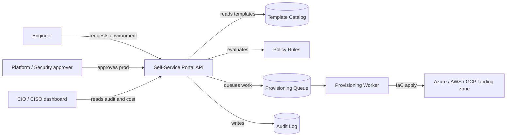
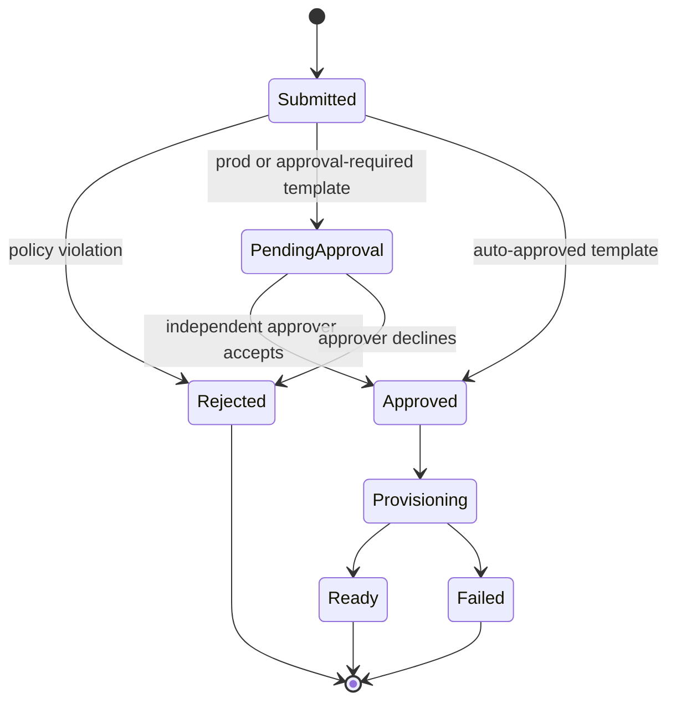
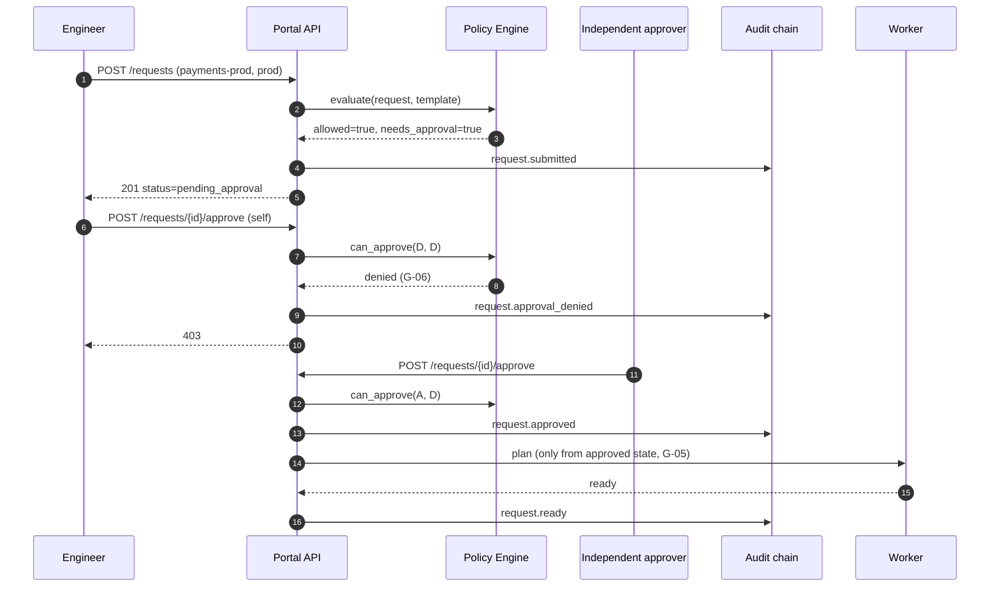
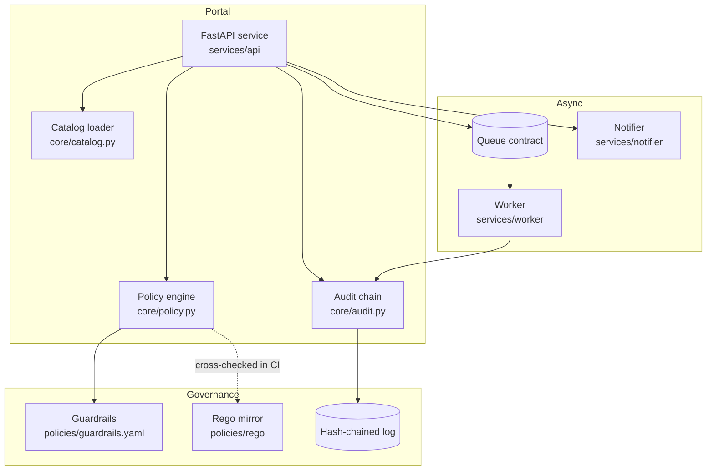
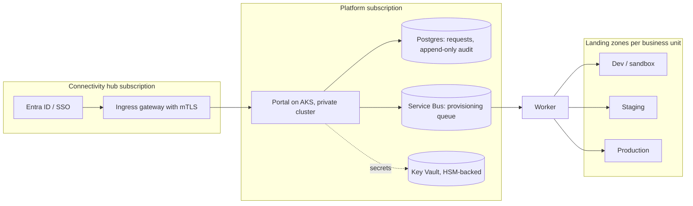

# Developer Self-Service Environment Portal

> **About (GitHub repository description):** Policy-gated developer self-service environment portal: golden-path templates, independent approvals, segregation of duties and a tamper-evident audit trail for regulated enterprises.

Engineers request approved "golden path" environments (sandboxes, staging, production landing zones) without filing tickets. Every request is checked against a reviewed catalog and a policy set in the same call. Production always needs a named approver who is not the requester. Every decision is written to a hash-chained audit log, and provisioning runs only from approved requests.

Built for regulated enterprises (banks, federal agencies, parastatals, Fortune 100 and 500 companies) where the executive questions are: how fast can teams ship, what does it cost, and can we prove who approved what?

## Business problem and answer

| Executive concern | How the portal answers it | Guardrail |
|---|---|---|
| Time to environment | Golden-path templates provision in one request instead of a multi-week ticket queue | Catalog |
| Cost exposure | Each request carries an estimated monthly cost checked against a hard ceiling; over-ceiling requests are refused | G-02 |
| Shadow IT | Only catalogued templates can be requested; unknown templates return 404 | Catalog |
| Entitlement | Teams may only request templates they are entitled to, from directory groups | G-03 |
| Control over production | Production always needs an independent approver; the API refuses self-approval | G-01, G-06 |
| Audit evidence | Hash-chained audit log that detects any edit or deletion; verifiable on demand | G-04, G-07 |
| Non-production sprawl | Sandboxes and staging expire automatically; production never auto-expires | Lifecycle |

## Architecture

The full set of views (containers, components, state machine, approval sequence, deployment topology, data classification, audit chain and failure recovery) is in [`docs/architecture/README.md`](docs/architecture/README.md). The core views are summarised here.

### 1. Context: who touches the portal



### 2. Request lifecycle



### 3. Sequence: production request with segregation of duties



### 4. Components



### 5. Deployment topology (reference)



## Repository layout

The repository has 35 folders. Each one has a README that explains its purpose and what it governs.

| Area | Folders | Purpose |
|---|---|---|
| Automation | `.github`, `.github/workflows`, `.github/ISSUE_TEMPLATE` | CI pipeline, template intake form |
| Catalogue | `catalog`, `catalog/schemas` | Reviewed golden-path templates and their schema |
| Documentation | `docs`, `docs/architecture`, `docs/adr`, `docs/runbooks`, `docs/security`, `docs/executive` | Architecture views, decisions, runbooks, threat model, executive briefing |
| Infrastructure | `infra`, `infra/terraform`, `infra/terraform/modules`, `infra/terraform/modules/sandbox-web`, `infra/terraform/modules/app-staging`, `infra/terraform/modules/payments-prod` | Landing-zone composition and one module per template |
| Policy | `policies`, `policies/rego`, `policies/examples` | Guardrails, Rego mirror, expected-decision cases |
| Services | `services`, `services/api`, `services/api/routes`, `services/api/core`, `services/worker`, `services/worker/adapters`, `services/notifier` | API, provisioning worker and notifier |
| Quality | `tests`, `tests/unit`, `tests/integration` | Control tests, each named for the guardrail it proves |
| Operations | `scripts`, `observability`, `identity`, `cost`, `lifecycle` | Tooling, alerts and SLOs, entitlements, budgets, expiry |

## Run it locally (Windows PowerShell)

```powershell
cd services\api
python -m venv .venv
.\.venv\Scripts\Activate.ps1
pip install -r requirements.txt
uvicorn main:app --reload
```

Open http://127.0.0.1:8000/docs. In a second window, run the demo that triggers every control:

```powershell
python scripts\demo_requests.py --base http://127.0.0.1:8000
```

Run the tests from the repository root:

```powershell
pytest -q
```

## Push to GitHub (Windows PowerShell)

Requires `git` and the GitHub CLI (`gh auth login` once). Run from the repository root:

```powershell
git init -b main
git add .
git commit -m "feat: developer self-service environment portal, first complete build"
gh repo create Adamson-lab/developer-self-service-portal --private --description "Policy-gated developer self-service environment portal: golden-path templates, independent approvals, segregation of duties and a tamper-evident audit trail for regulated enterprises" --source . --remote origin --push
```

To make the repository public instead, replace `--private` with `--public`. The same commands are in `scripts/push-to-github.ps1`.

## Status

Second build. The API, policy engine (Python and Rego), audit chain, worker, adapters, notifier, Terraform composition, CI pipeline, runbooks and executive briefing are all present.

Still open before production, and tracked in `docs/security/threat-model.md`:

- Storage is in memory. Postgres with append-only audit is required.
- Approver identity is taken from the request body. It must be bound to the Entra ID token at the gateway.
- Provisioning runs synchronously through the dry-run adapter. Service Bus with the Terraform adapter on the landing-zone runner is required.
- Break-glass access has no design yet (see ADR 0004).

## Licence and ownership

Owned by the platform team. Changes to `policies/`, `catalog/` and `infra/terraform/modules/` require Security or Platform review through CODEOWNERS.
