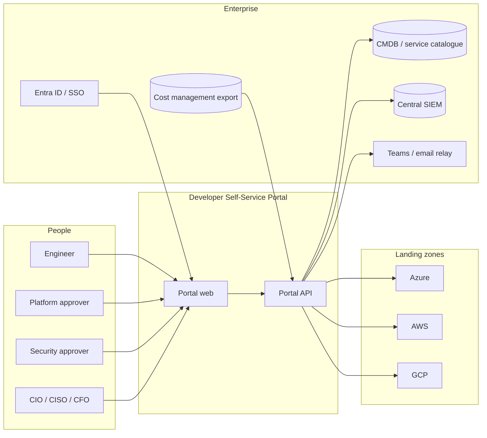
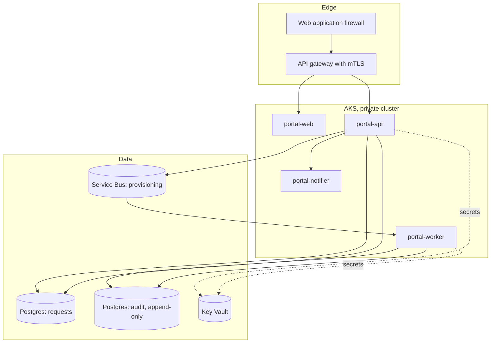
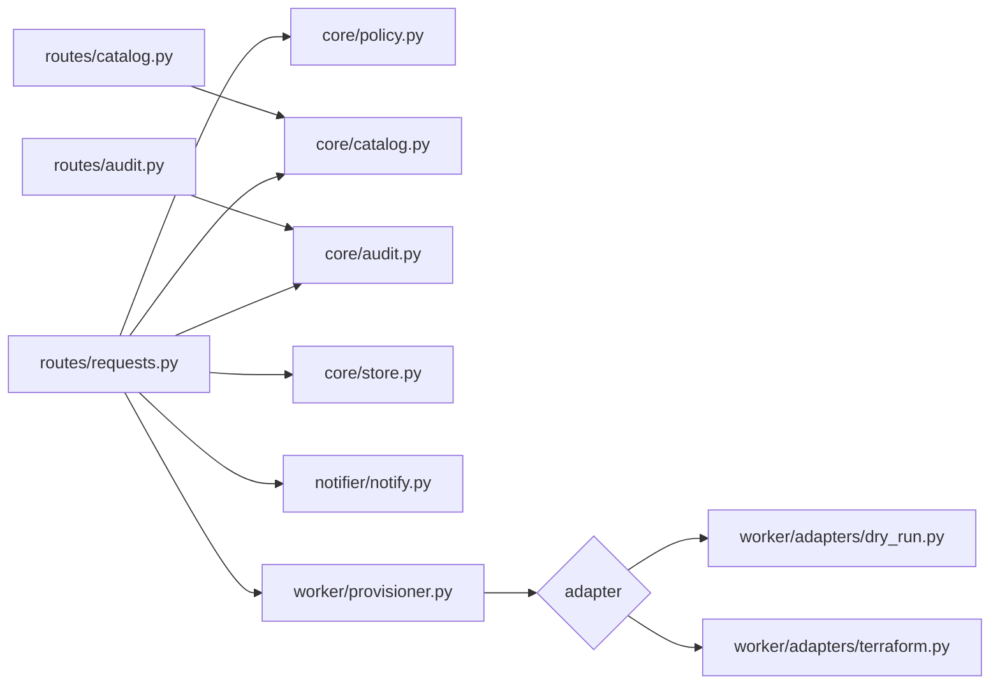
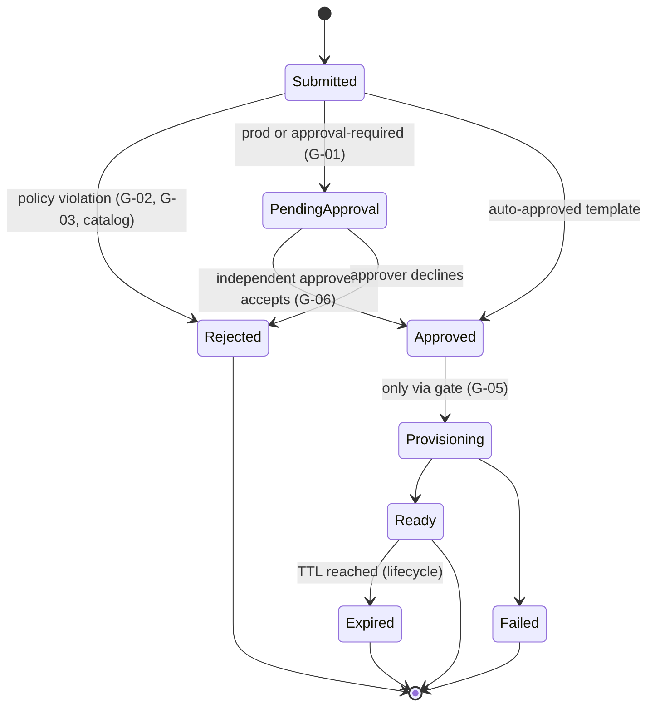
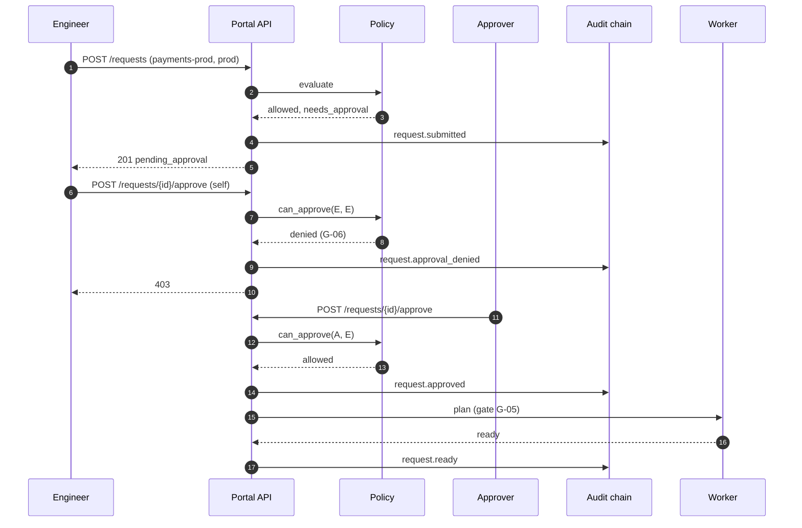
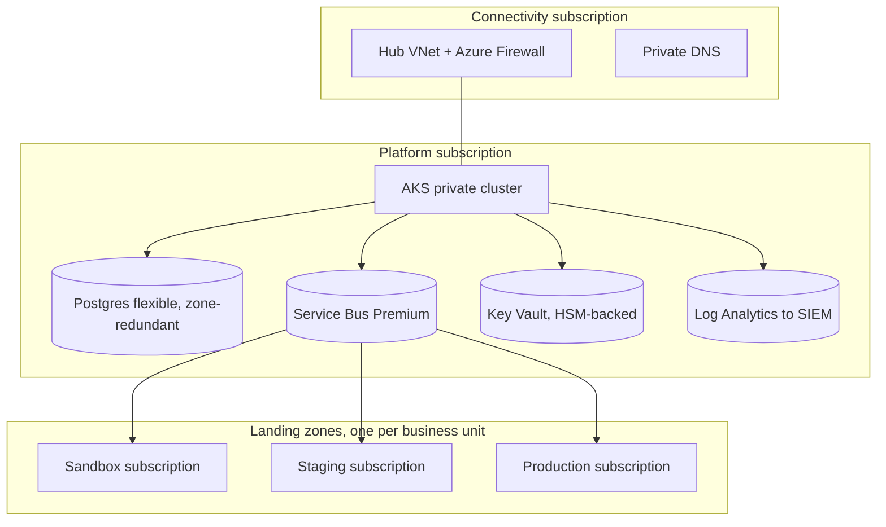
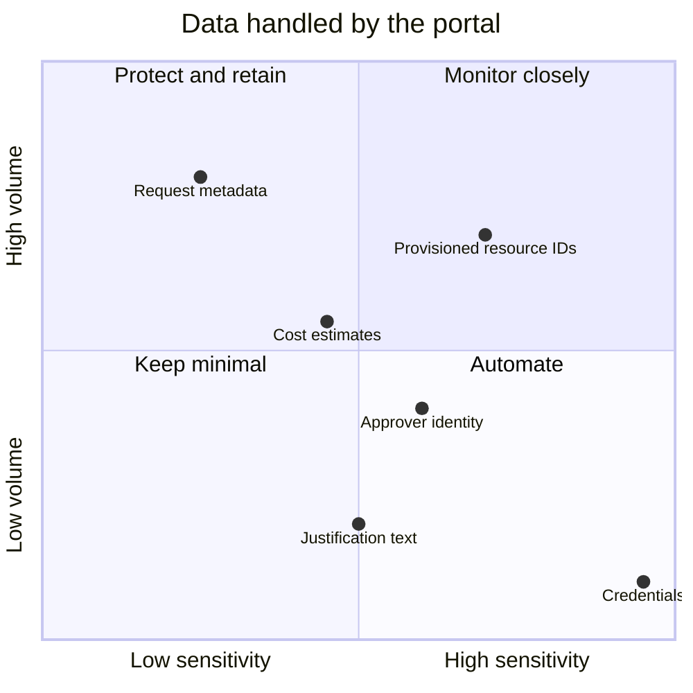
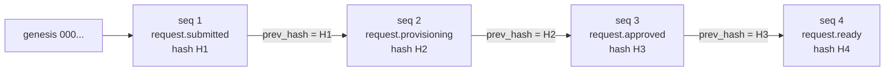
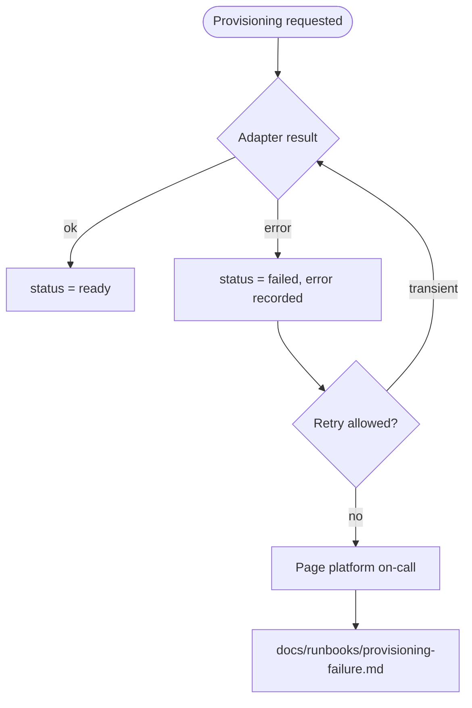

# Architecture

This document is the detailed companion to the summary in the root README. It contains
the full set of views a design authority expects: context, containers, components,
request lifecycle, approval sequence, deployment, data classification, and the audit chain.

## 1. System context

## 2. Containers

## 3. Components inside the API

## 4. Request state machine

## 5. Approval sequence with segregation of duties

## 6. Deployment topology

## 7. Data classification

Credentials never pass through the portal. Workers use managed identities from the landing-zone runner.

## 8. Audit chain

Each hash covers the entry body and the previous hash. Editing or deleting any entry breaks
every hash after it, which `GET /audit/verify` reports as `first_broken_seq`.

## 9. Failure and recovery

## Design decisions

See `docs/adr/` for the reasoning behind policy-as-code (0001), the first-build synchronous
adapter (0002), hash-chained audit (0003), and the mandatory approver separation (0004).
